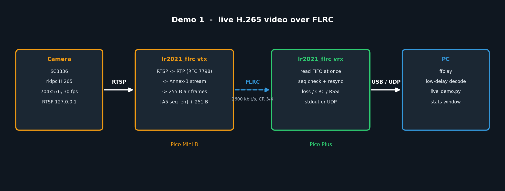

# Demo 1 - Live H.265 video over LR2021 FLRC

A Luckfox Pico Mini B films with its SC3336 camera, the RV1103 encodes H.265, and `lr2021_flrc vtx` sends the stream over the
LR2021 FLRC radio. A Luckfox Pico Plus receives it with `lr2021_flrc vrx` and forwards it to a PC, where `ffplay` decodes and
displays it live.




[Watch the demo video](media/video_demo.mp4)

## How it works

**Transmitter (`vtx`, Pico Mini B)**
1. Connects to the camera's local RTSP server (`rtsp://127.0.0.1/live/1`, provided by `rkipc`), using RTP over TCP (interleaved).
2. Unpacks RTP H.265 (RFC 7798): single NAL units, aggregation packets (type 48) and fragmentation units (type 49).
3. Rebuilds an Annex-B byte stream (`00 00 00 01` start codes).
4. Cuts it into 255-byte air frames: `[0xA5][seq_hi][seq_lo][len]` + up to 251 bytes of video.
5. At the end of each picture (RTP marker bit) the partial frame is sent at once to keep latency low.

**Receiver (`vrx`, Pico Plus)**
1. Continuous RX. On every `RxDone` the 255-byte packet is read immediately (the FIFO holds only one packet).
2. Checks the sync byte, counts lost packets from the sequence number, flushes and resynchronises if the FIFO is misaligned.
3. Writes the video bytes to stdout (`-H -`) or sends them as UDP to a PC (`-H <ip> -p <port>`).
4. Every 2 s prints: good packets, CRC errors, lost, resyncs, RSSI and bit rate.

## Run it

On the receiver (Pico Plus):
```sh
lr2021_flrc vrx -b 54 -r 55 -R 0 -c 1 -H 192.168.50.1 -p 5000      # UDP to the PC
```
On the PC:
```sh
ffplay -fflags nobuffer -flags low_delay -framedrop -f hevc udp://0.0.0.0:5000
```
On the transmitter (Pico Mini B, camera service `rkipc` running):
```sh
lr2021_flrc vtx -b 54 -r 55 -R 0 -c 1 -g 1000 -u /live/1
```

### Live window with stats (`live_demo.py`)

Runs everything from the PC through `adb` (no Ethernet needed): receiver output is streamed over `adb shell`
(terminal switched to raw mode so binary data passes unchanged) into `ffplay`, next to a window with a millisecond clock
and the receiver statistics.

```sh
export PLUS_ADB=<serial of the Pico Plus> MINI_ADB=<serial of the Pico Mini B>   # from `adb devices`
python3 live_demo.py --seconds 120 --rate 0 --cr 1 --gap 1000 [--record demo.mp4]
```

The clock is there to measure glass-to-glass latency: point the camera at the clock, then latency = clock on screen minus
clock seen in the received video.

## Measured on the bench

FLRC 2440 MHz, 2600 kbit/s raw, coding rate 3/4, 0 dBm conducted, boards a short distance apart.

| Run | Packets received | Lost | CRC errors | RSSI | Video |
|---|---|---|---|---|---|
| 96 s live, gap 1 ms | 6996 | 0 | 1 | -36 to -38 dBm | 704x576, ~80-250 kbit/s depending on the scene |
| 20 s recorded, 1300 kbit/s, gap 1.5 ms | 1156 | 0 | 1 | -38.5 dBm | 498 frames decoded |

Lessons learned:
- The gap between packets matters: with 0.5 ms the Linux receiver sometimes missed packets (75 lost / 16 resyncs in 124 s);
  1 ms was clean.
- Decoding starts on the first I-frame, so the picture appears after up to one GOP.
- **Not measured yet:** glass-to-glass latency and range.
