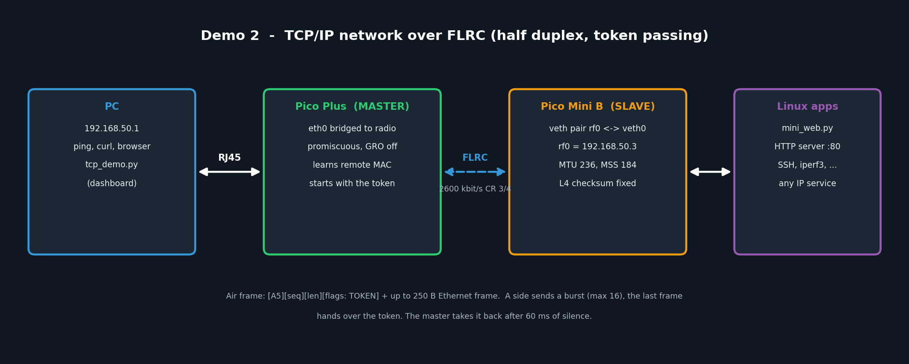

# Demo 2 - TCP/IP network over LR2021 FLRC

The LR2021 radio becomes a normal IP link. Any Linux application can use it unchanged: `ping`, `ssh`, `curl`, a web
browser, a file transfer. In this demo a PC opens a **web page served by the Pico Mini B through the radio** and downloads a
**photo over TCP/HTTP**.

This opens the door to using FLRC for real data communication (files, pictures, telemetry, remote shell, software
updates), not only for small fixed-format sensor packets.



[Watch the demo video](media/tcpip_demo.mp4)

## Topology

```
PC 192.168.50.1 --RJ45-- Pico Plus (bridge eth0 <-> radio, MASTER) ~~FLRC 2.44 GHz~~ Pico Mini B (rf0 192.168.50.3, SLAVE)
```

- **Pico Plus**: its Ethernet port is bridged to the radio. The program opens a raw `AF_PACKET` socket on `eth0` in
  promiscuous mode, forwards broadcast frames and frames for the learned remote MAC, and turns GRO off so incoming TCP
  segments are never merged into frames larger than one radio packet.
- **Pico Mini B**: a `veth` pair. `rf0` carries the IP address, the program owns the other end (`veth0`) with a raw socket.
  Linux sees `rf0` as a normal network card.

## Link protocol

- Half duplex with **token passing**: one side transmits a burst (up to 16 frames, `-B`); the last frame carries the TOKEN flag
  and the other side may then transmit. With nothing to send, a side sends an empty token frame.
- The master starts with the token and takes it back after 60 ms of silence (`-T`).
- Air frame: `[0xA5][seq_hi][seq_lo][len][flags]` + up to 250 bytes of Ethernet frame.
- MTU 236 on the radio interfaces. TCP MSS is clamped to 184 in SYN packets that cross the radio, so the PC never sends
  segments that do not fit.
- `veth` leaves TCP/UDP checksums "partial" (offload): the program completes them before the frame goes on air.

## Run it

Pico Mini B (slave):
```sh
rf_net.sh 192.168.50.3/24             # creates rf0 / veth0
lr2021_flrc net -I veth0 -b 54 -r 55 -R 0 -c 1
python3 mini_web.py &                 # demo web server on 192.168.50.3:80 (photo in /tmp/photo.jpg)
```
Pico Plus (master, bridge):
```sh
ip addr add 192.168.50.2/24 dev eth0
lr2021_flrc net -I eth0 -M -L -b 54 -r 55 -R 0 -c 1
```
PC (Ethernet `192.168.50.1/24` on the cable to the Pico Plus):
```sh
ping 192.168.50.3
curl -o photo.jpg http://192.168.50.3/photo.jpg
firefox http://192.168.50.3
export PLUS_ADB=<serial> MINI_ADB=<serial>; python3 tcp_demo.py   # live dashboard
```

The dashboard shows the network path, a live ping graph through the radio, loss counters and the radio statistics of both
boards. The web page (`mini_web.py`) shows live board information refreshed every second, the HTTP round trip over the radio,
and a photo transferred over TCP with its load time.

## Measured on the bench

FLRC 2440 MHz, 2600 kbit/s raw, coding rate 3/4, 0 dBm conducted, boards a short distance apart.

| Test | Result |
|---|---|
| Ping PC -> Mini B through the radio | 40/40, 0 % loss, 14-29 ms round trip (average 21 ms) |
| Dashboard run (about 108 pings) | 1 lost, median 21.5 ms |
| HTTP download of a 15 KB JPEG (curl) | 1.7 s |
| Same photo in a browser | 2.9 s |
| HTTP round trip of the live info request | 80-90 ms |

Lesson learned: Linux scheduling pauses on the slave matter more than the radio. With the camera service (`rkipc`) running
on the Pico Mini B, the slave missed about 30 % of the master's frames (pauses of 10-17 ms) and ping loss was 13-15 %. With
the camera stopped: 0 % loss.

**Not measured yet:** range, sustained TCP throughput on this setup, behaviour with interference.
