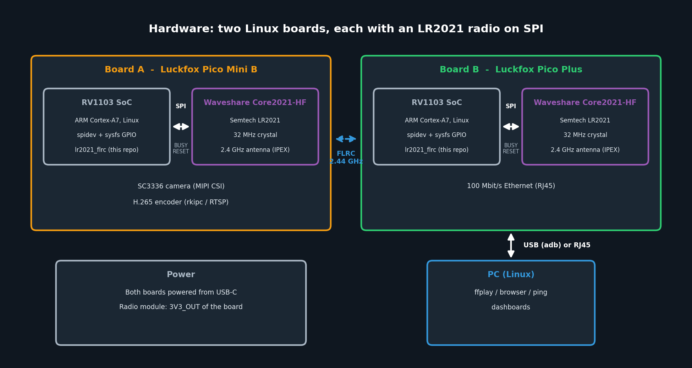
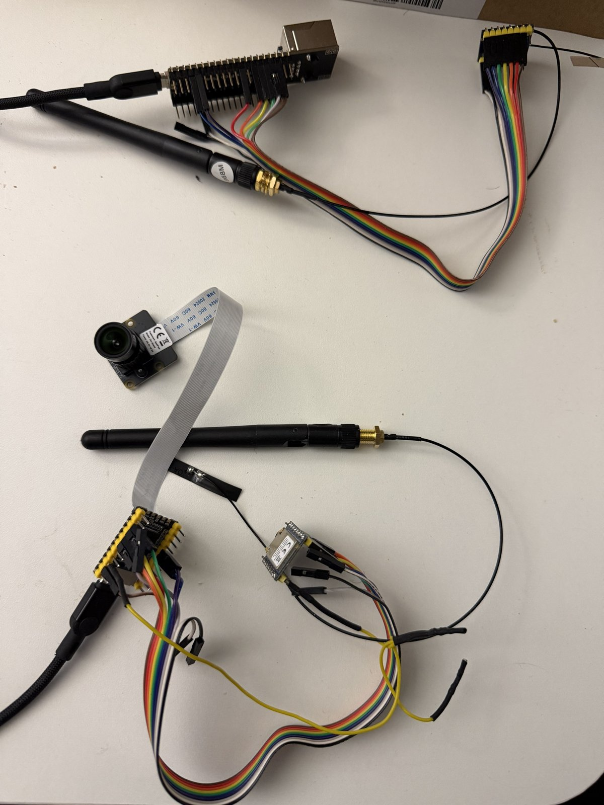
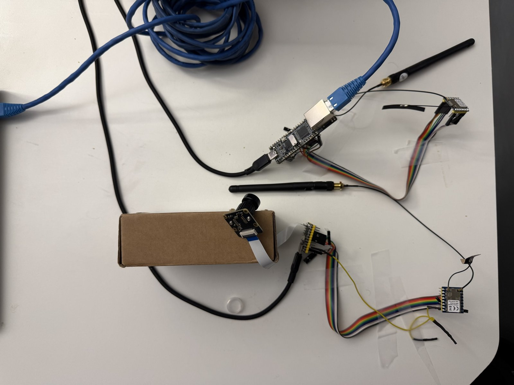
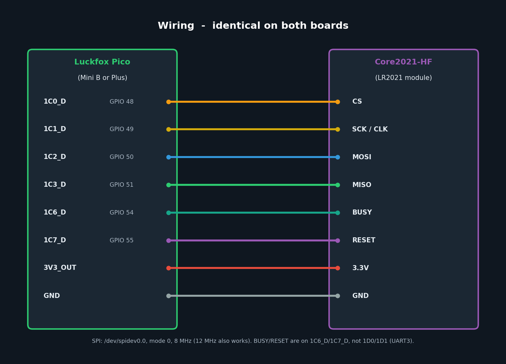

# LR2021 FLRC on Linux: live video and TCP/IP over a 2.4 GHz radio link

Two open-source demos that drive a **Semtech LR2021** transceiver from Linux (plain `spidev` + sysfs GPIO, no kernel driver)
on low-cost **Luckfox Pico** boards (Rockchip RV1103), using the LR2021 **FLRC** modem at 2.4 GHz:

| Demo | What it shows | Folder |
|---|---|---|
| 1. Live video | H.265 camera stream sent over FLRC and decoded live on a PC | [`01-video-over-flrc`](01-video-over-flrc) |
| 2. TCP/IP | A real IP network over FLRC: ping, HTTP web page, photo download, any TCP/UDP service | [`02-tcpip-over-flrc`](02-tcpip-over-flrc) |

The LR2021 is Semtech's multi-protocol transceiver of the LoRa family: besides LoRa it has an **FLRC** modem
(Fast Long Range Communication, GMSK, up to 2.6 Mbit/s raw). These demos use FLRC to carry ordinary data
(video, Ethernet frames, TCP/IP) instead of the small sensor packets usually associated with LoRa radios.



## The real bench

| Both nodes | Bench during the TCP/IP demo |
|---|---|
|  |  |

Top / right: Luckfox Pico Plus (RJ45) with its Core2021-HF module. Bottom / left: Luckfox Pico Mini B with the SC3336 camera
and its Core2021-HF module. Each module drives a 2.4 GHz antenna through an IPEX-to-SMA pigtail. Flat ribbon jumpers carry
SPI, BUSY, RESET, 3.3 V and GND.

## Hardware

| Qty | Part | Role |
|---|---|---|
| 1 | Luckfox Pico Mini B (RV1103, Linux) + SC3336 camera | transmitter / remote node |
| 1 | Luckfox Pico Plus (RV1103, Linux, Ethernet RJ45) | receiver / gateway |
| 2 | Waveshare Core2021-HF module (Semtech LR2021, 32 MHz crystal) | radio |
| 2 | 2.4 GHz antenna (IPEX / u.FL) | |
| | jumper wires, USB-C cables, 1 Ethernet cable | |

## Wiring (same on both boards)



| Luckfox pin | Linux GPIO | Core2021-HF |
|---|---|---|
| 1C0_D | 48 | CS |
| 1C1_D | 49 | SCK |
| 1C2_D | 50 | MOSI |
| 1C3_D | 51 | MISO |
| 1C6_D | 54 | BUSY |
| 1C7_D | 55 | RESET |
| 3V3_OUT | | 3.3V |
| GND | | GND |

SPI is `/dev/spidev0.0`, mode 0. 8 MHz is reliable; 16 MHz failed on our bench.

## Build

```sh
make                                                    # native build (compile check)
make CC=arm-rockchip830-linux-uclibcgnueabihf-gcc       # Luckfox Pico SDK toolchain
adb push lr2021_flrc /usr/bin/                          # on each board
```

## The `lr2021_flrc` program

One binary, one mode per command:

| Mode | Purpose |
|---|---|
| `tx` / `rx` | packet test: count, loss, CRC errors, packet error rate |
| `btx` | bulk throughput test with the video framing |
| `vtx` / `vrx` | video demo: camera RTSP stream -> FLRC -> stdout or UDP |
| `net` | TCP/IP demo: Ethernet frames over FLRC (bridge or veth) |
| `tsrv` | small TCP throughput server (no radio) |

Common options: `-b 54 -r 55` (BUSY / RESET GPIO), `-f 2440000000` (Hz), `-R 0..7` (0 = 2600, 1 = 2080, 2 = 1300 kbit/s ...),
`-c 0..3` (coding rate: 0 = 1/2, 1 = 3/4, 2 = none, 3 = 2/3), `-P dBm` (-19..10, default 0).

All radio commands come from the public LR2021 datasheet (SetPacketType FLRC, SetFlrcModulationParams,
SetFlrcPacketParams, SetFlrcSyncword, SetPaConfig, SetTxParams, ...).

## Radio frame and the one-packet FIFO

Every air frame is 255 bytes: `[0xA5][seq_hi][seq_lo][len]` + payload, zero padded. The LR2021 RX FIFO holds a single
255-byte packet, so the receiver reads each packet immediately after `RxDone`; the fixed length and the `0xA5` sync byte let it
detect a misaligned FIFO, flush it and resynchronise. The transmitter waits a short gap (`-g`, default 1500 us) after each
packet so that the Linux receiver has time to empty the FIFO.

## Regulatory note

The default output power is 0 dBm conducted. In the 2.4 GHz ISM band (for example EN 300 328 in Europe) the limit for a
non-adaptive device is 10 dBm EIRP: subtract your antenna gain. Check the rules that apply where you operate.

## Status

Bench results only, boards a short distance apart. Range, long-term reliability and glass-to-glass video latency have
**not** been measured yet. See each demo folder for the measured numbers.

## License

MIT, see [LICENSE](LICENSE).
